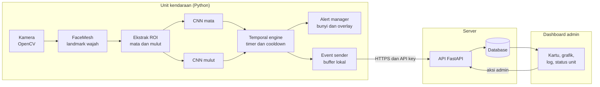
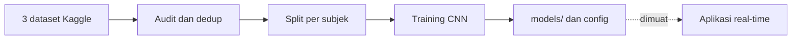
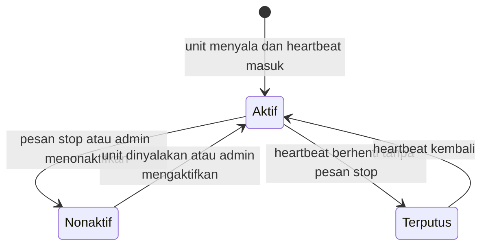
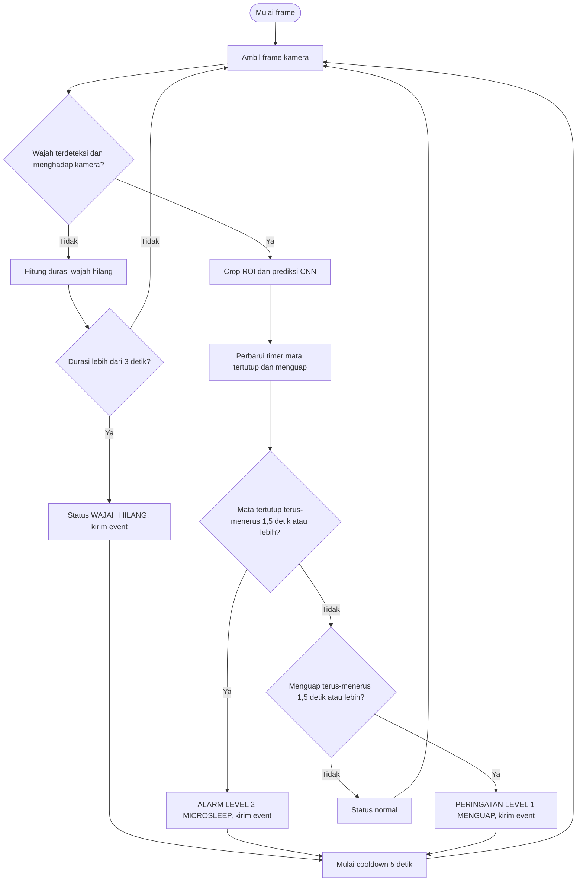

# Microsleep Detection: Pemantau Kantuk Pengemudi dengan Computer Vision

Dokumen ini adalah bahan belajar bersama untuk tim. Baca berurutan dari atas ke bawah sebelum mulai mengerjakan.

Catatan penting tentang isi dokumen:
- Bagian bertanda **(Asumsi)** adalah keputusan awal yang masih boleh diubah lewat diskusi tim.
- Semua angka threshold (durasi, cooldown, sudut kepala) adalah **nilai awal**. Nilai akhir ditentukan lewat eksperimen, bukan ditebak.
- Detail ketiga dataset Kaggle (struktur kelas, lisensi, ID subjek) **belum terverifikasi**. Verifikasinya adalah tugas minggu pertama.

## Daftar Isi

1. [Pengenalan Project](#1-pengenalan-project)
2. [Tujuan](#2-tujuan)
3. [Contoh Penggunaan](#3-contoh-penggunaan)
4. [Konsep Dasar yang Perlu Dipahami](#4-konsep-dasar-yang-perlu-dipahami)
5. [Sumber Data](#5-sumber-data)
6. [Desain Arsitektur](#6-desain-arsitektur)
7. [Flowchart Sistem](#7-flowchart-sistem)
8. [Data dan Model](#8-data-dan-model)
9. [Struktur Folder](#9-struktur-folder)
10. [Hal yang Perlu Diperhatikan](#10-hal-yang-perlu-diperhatikan)
11. [Evaluasi](#11-evaluasi)
12. [Pembagian Tugas dan Rencana 6 Minggu](#12-pembagian-tugas-dan-rencana-6-minggu)
13. [Pengembangan Lanjutan](#13-pengembangan-lanjutan)
14. [Checklist Selesai](#14-checklist-selesai)

---

## 1. Pengenalan Project

**Microsleep Detection** adalah sistem computer vision yang memantau pengemudi lewat kamera yang menghadap wajahnya, lalu mendeteksi tiga kondisi:

| Status | Arti singkat |
|---|---|
| **Wajah hilang** | Wajah tidak terlihat atau tidak menghadap kamera |
| **Menguap** (Level 1) | Tanda awal kantuk |
| **Microsleep** (Level 2) | Mata tertutup berkepanjangan, tanda bahaya |

Sistem terdiri dari tiga bagian:

| Bagian | Fungsi |
|---|---|
| **Aplikasi real-time di unit** (Python) | Membaca kamera, mengenali mata dan mulut, membunyikan alarm di kabin, dan mengirim event ke server |
| **Server (API + database)** | Menerima event dan heartbeat dari unit, menyimpannya |
| **Dashboard admin** (web) | Menampilkan ringkasan, grafik, log event, dan status perangkat tiap unit. Hanya untuk admin |

### Latar belakang urgensi

Microsleep adalah tertidur sangat singkat (hitungan detik) tanpa disadari pengemudi. Beberapa kejadian yang diberitakan pada 2026 diduga terkait kantuk atau microsleep:

- 7 Juli 2026: kecelakaan bus PO Pelangi menabrak bagian belakang truk di tol Pekanbaru-Dumai, dua penumpang meninggal dan 16 orang luka-luka. Sopir disebut mengalami microsleep.
- 18 Juli 2026: kecelakaan beruntun di Tol JORR. Polisi menduga sopir mengantuk atau microsleep.
- 27 September 2026: polisi menyebut microsleep sebagai penyebab utama dugaan kecelakaan truk tangki di Tol Jagorawi.

> Kutipan di atas berasal dari pemberitaan media dan statusnya dugaan. **Cek sumber aslinya sebelum dikutip di laporan.**

### Skenario pengguna potensial

Perusahaan dengan armada pengiriman (misalnya perusahaan distribusi bahan bakar seperti Pertamina) bisa memasang kamera di kabin dan memantau unit lewat dashboard. **Ini contoh skenario, bukan klaim kerja sama atau penggunaan oleh perusahaan mana pun.**

### Posisi project ini

| Yang **adalah** | Yang **bukan** |
|---|---|
| Prototipe akademik dengan evaluasi dan analisis keterbatasan | Alat keselamatan bersertifikat |
| Alat bantu peringatan | Diagnosis medis |
| Indikator untuk ditinjau manusia | Bukti pelanggaran sopir |

Sistem sejenis umumnya sudah tersedia secara komersial. Nilai project ini ada pada rancangannya, evaluasinya yang jujur, dan analisis keterbatasannya.

---

## 2. Tujuan

### Tujuan produk

- Memberi peringatan dini di kabin saat pengemudi menguap (Level 1) dan alarm keras saat terindikasi microsleep (Level 2).
- Memberi admin gambaran kondisi armada: unit mana yang aktif, kapan dan seberapa sering kejadian muncul.
- Menekan alarm palsu seminimal mungkin, karena alarm yang terlalu sering diabaikan pengemudi.

### Tujuan teknis

- Membangun pipeline lengkap: **data → audit → training → evaluasi → aplikasi real-time → server dan dashboard**.
- Membandingkan pendekatan geometri (EAR/MAR), MLP pada landmark, dan CNN pada crop gambar, lalu menunjukkan mana yang lebih baik dan kenapa.
- Mencapai inferensi real-time di CPU laptop (target awal: **minimal 15 FPS**) **(Asumsi)**.
- Mengukur kinerja pada level **kejadian** (delay deteksi, alarm palsu per jam), bukan hanya akurasi per gambar.

### Tujuan pembelajaran tim

- Memahami alur kerja project machine learning dari data sampai sistem yang berjalan.
- Terbiasa memisahkan **eksperimen** (notebook) dari **kode yang dipakai sistem** (`.py`).
- Memahami evaluasi yang jujur: split per subjek, uji eksternal, domain shift, dan alarm palsu.
- Memahami pertimbangan etika dan privasi pada sistem yang memantau manusia.

### Di luar lingkup versi awal

- PERCLOS (proporsi waktu mata tertutup). Dicatat sebagai pengembangan lanjutan.
- Video langsung (live stream) ke dashboard.
- Pelacakan lokasi (GPS).
- Klaim diagnosis kantuk atau kelelahan secara medis.

---

## 3. Contoh Penggunaan

### Skenario sopir

1. Sopir menyalakan unit. Aplikasi real-time berjalan, kamera aktif, dan status unit menjadi **Aktif**.
2. Sopir menguap sekitar 1,5 detik atau lebih. Sistem membunyikan peringatan lembut dan menampilkan saran istirahat (**Level 1**).
3. Mata sopir tertutup terus-menerus sekitar 1,5 detik atau lebih. Alarm keras berbunyi (**Level 2, kemungkinan microsleep**).
4. Wajah sopir tidak terdeteksi lebih dari 3 detik (kamera terhalang atau sopir menoleh). Sistem mencatat **Wajah hilang**.
5. Tiap kejadian dikirim ke server sebagai event. Jika sinyal hilang, event ditahan di buffer lokal dan dikirim ulang saat sinyal kembali.

### Skenario admin

1. Admin login ke dashboard.
2. Admin melihat empat kartu ringkasan, grafik event per jam, log event, dan status tiap unit.
3. Admin memfilter log berdasarkan unit atau jenis kejadian, lalu mengekspor CSV bila perlu.
4. Admin menonaktifkan unit yang sedang perawatan dan mengisi alasannya. Perubahan ini tercatat di audit log.

### Tiga status sistem

| Status | Pemicu (nilai awal) | Level | Respons di unit | Dikirim ke dashboard |
|---|---|---|---|---|
| **Wajah hilang** | Wajah tidak terdeteksi atau tidak menghadap kamera > 3 detik | Status tersendiri (bukan Level 1/2) | Pesan ringan di layar | Ya |
| **Menguap** | Mulut berstatus *yawn* terus-menerus ≥ 1,5 detik | **Level 1** | Bunyi lembut + saran istirahat | Ya |
| **Microsleep** | Mata berstatus *closed* terus-menerus ≥ 1,5 detik | **Level 2** | Alarm keras | Ya |

Cooldown 5 detik setelah tiap peringatan agar alarm tidak berulang tanpa henti.

### Isi dashboard admin

| Komponen | Isi |
|---|---|
| **4 kartu** | Unit aktif (dari total), Microsleep (L2) hari ini, Menguap (L1) hari ini, Wajah hilang hari ini |
| **Grafik** | Batang bertumpuk: jumlah event per jam, dibedakan per jenis. Ada filter unit dan periode |
| **Status perangkat** | Daftar unit dengan label Aktif / Nonaktif (dan Terputus), waktu heartbeat terakhir, tombol Nonaktifkan/Aktifkan |
| **Log event** | Waktu, unit, ID sopir (anonim), jenis, level, durasi. Ada filter dan ekspor CSV |

### Contoh `config.json` di unit

```json
{
  "unit_id": "unit-01",
  "camera_index": 0,
  "frame_width": 640,
  "frame_height": 480,
  "eye_closed_seconds": 1.5,
  "yawn_seconds": 1.5,
  "face_lost_seconds": 3.0,
  "cooldown_seconds": 5.0,
  "head_pitch_max_deg": 25,
  "heartbeat_seconds": 10,
  "server_url": "https://ALAMAT-SERVER/api",
  "api_key": "ISI-DARI-ENV-JANGAN-DI-COMMIT"
}
```

| Parameter | Keterangan |
|---|---|
| `eye_closed_seconds` | Durasi mata tertutup berkelanjutan untuk memicu Level 2 |
| `yawn_seconds` | Durasi menguap berkelanjutan untuk memicu Level 1 |
| `face_lost_seconds` | Durasi wajah hilang untuk mencatat status Wajah hilang |
| `cooldown_seconds` | Jeda setelah peringatan |
| `head_pitch_max_deg` | Batas sudut menunduk. Melewati batas dianggap tidak menghadap kamera (nilai awal, perlu dikalibrasi) |
| `api_key` | Jangan disimpan di repositori. Pakai variabel lingkungan atau file yang masuk `.gitignore` |

---

## 4. Konsep Dasar yang Perlu Dipahami

| Istilah | Penjelasan singkat |
|---|---|
| **Microsleep** | Tertidur sangat singkat (hitungan detik) tanpa disadari. Di kamera tampak sebagai mata yang tertutup lebih lama dari kedipan normal. |
| **Kedipan normal** | Mata menutup sangat singkat, jauh lebih cepat dari 1,5 detik. Karena itu durasi menjadi pembeda microsleep dari kedipan. |
| **Landmark** | Titik-titik penting pada wajah. MediaPipe FaceMesh menghasilkan 468 titik (478 jika mode iris diaktifkan), masing-masing dengan koordinat x, y, z. |
| **ROI (Region of Interest)** | Bagian gambar yang diambil (di-*crop*) untuk dianalisis, di sini area mata dan mulut. |
| **EAR (Eye Aspect Ratio)** | Rasio jarak vertikal terhadap horizontal mata. Nilainya turun mendekati nol saat mata menutup. |
| **MAR (Mouth Aspect Ratio)** | Rasio jarak vertikal terhadap horizontal mulut. Nilainya naik jauh saat mulut terbuka lebar. |
| **CNN** | Jaringan saraf yang membaca gambar. Di sini inputnya crop mata atau mulut kecil, outputnya probabilitas kelas. |
| **Confidence** | Probabilitas tertinggi hasil prediksi, misalnya "mata tertutup dengan keyakinan 0,94". |
| **Hold time** | Lama sebuah kondisi harus bertahan **tanpa terputus** sebelum peringatan dipicu. |
| **Cooldown** | Jeda setelah peringatan, selama itu peringatan berikutnya ditahan. |
| **Heartbeat** | Sinyal kecil yang dikirim unit secara berkala ("saya masih hidup"). Dipakai server untuk menentukan status Aktif/Terputus. |
| **Store-and-forward** | Event disimpan lokal dulu, lalu dikirim saat koneksi tersedia. Cocok untuk kendaraan yang sinyalnya tidak stabil. |
| **Domain shift** | Perbedaan kondisi data latih dan data pemakaian nyata (kamera, cahaya, sudut). Penyebab umum akurasi bagus di evaluasi tapi buruk di lapangan. |
| **Data leakage** | Data uji "bocor" ke data latih, misalnya gambar subjek yang sama atau gambar duplikat ada di keduanya. Akurasi tampak tinggi secara palsu. |
| **False alarm / false negative** | False alarm: sistem berbunyi padahal tidak ada kejadian. False negative: kejadian nyata tidak terdeteksi. Keduanya perlu diukur. |
| **Level event vs level frame** | Evaluasi frame menilai satu gambar. Evaluasi event menilai kejadian utuh (misalnya "apakah microsleep 2 detik ini terdeteksi, dan berapa detik terlambat"). |

---

## 5. Sumber Data

### 5.1 Ringkasan sumber

Model dilatih dari **gambar** (piksel), bukan dari koordinat landmark. Ada dua sumber data:

| Sumber | Jenis | Fungsi |
|---|---|---|
| **Tiga dataset Kaggle** | Gambar mata, mulut, dan wajah | Data latih, validasi, dan uji |
| **Rekaman video sendiri** | Video anggota tim yang memeragakan mata tertutup dan menguap (dengan persetujuan) | Evaluasi bagian temporal (event) dan uji pada kamera sendiri |

### 5.2 Tiga dataset Kaggle

| Dataset | Tautan | Yang terlihat di halamannya | Peran usulan | Yang harus dicek |
|---|---|---|---|---|
| Drowsiness dataset (hoangtung719) | https://www.kaggle.com/datasets/hoangtung719/drowsiness-dataset | Deskripsi menyebut lebih dari 11.000 gambar untuk deteksi kantuk | **Uji eksternal** (tidak dipakai melatih) jika isinya wajah utuh. Jika tidak cocok, jadikan data tambahan | Struktur kelas, resolusi, lisensi, duplikat |
| yawn_eye_dataset_new (serenaraju) | https://www.kaggle.com/datasets/serenaraju/yawn-eye-dataset-new | Deskripsi singkat "untuk deteksi kantuk" | Data **mulut** (yawn / no_yawn) dan data **mata RGB** | Dari ingatan, ada kelas Open, Closed, yawn, no_yawn. **Belum diverifikasi** |
| MRL dataset (prasadvpatil) | https://www.kaggle.com/datasets/prasadvpatil/mrl-dataset | Klasifikasi mata tertutup/terbuka | Data **utama model mata** | Asal kamera (setahu kami inframerah), jumlah gambar, ada tidaknya ID subjek di nama file |

> Halaman Kaggle hanya menampilkan deskripsi singkat saat dicek, sehingga struktur dan lisensi di atas **harus diaudit setelah diunduh**. Tulis lisensi dan sitasi ketiganya di laporan.

### 5.3 Audit data (minggu 1)

Isi tabel inventaris untuk tiap dataset:

- Jumlah gambar per kelas dan per folder (train/test jika ada).
- Resolusi, mode warna (RGB/grayscale), contoh gambar tiap kelas.
- Lisensi dan syarat penggunaan.
- Apakah ada ID subjek (misalnya di nama file) dan jumlah subjek.
- Dugaan duplikat dalam dan antar dataset.
- Gaya crop: seberapa ketat crop mata/mulut dan seberapa banyak area sekitarnya ikut masuk.

### 5.4 Unifikasi label

| Model | Kelas | Label numerik |
|---|---|---|
| Mata | open, closed | 0 = open, 1 = closed |
| Mulut | no_yawn, yawn | 0 = no_yawn, 1 = yawn |

Kelas positif (1) adalah kondisi yang ingin dideteksi, sehingga recall dan precision dihitung terhadap kelas itu.

### 5.5 Alur dari data mentah sampai siap latih

| Tahap | Proses | Lokasi |
|---|---|---|
| 1 | Unduh dataset dan rekam video sendiri | `data/raw/` |
| 2 | Audit (inventaris, lisensi, ID subjek) | notebook 01 |
| 3 | Buang duplikat dalam dan antar dataset (perceptual hash) | notebook 02 |
| 4 | Satukan ukuran crop dan mode warna (usulan: grayscale 64×64 untuk memperkecil jurang domain RGB vs inframerah) | `shared/preprocessing.py` |
| 5 | Pemetaan label ke 0/1 | notebook 02 |
| 6 | Split **per subjek** menjadi train/val/test, sisihkan uji eksternal | `data/processed/` |

### 5.6 Aturan pembagian data

- **Split per subjek, bukan acak per gambar.** Split acak membuat gambar subjek yang sama muncul di data latih dan uji (data leakage).
- **Hapus duplikat sebelum split**, termasuk duplikat antar dataset. Dataset Kaggle sering saling menyalin.
- Komposisi kasar 70% train, 15% validation, 15% test (boleh disesuaikan).
- **Test set hanya dibuka di notebook 06.** Pemilihan model dan tuning memakai validation set.
- **Uji eksternal** (satu dataset atau sebagian rekaman sendiri) tidak pernah ikut training.
- Jika dataset tidak punya ID subjek, gunakan pengelompokan alternatif (misalnya kemiripan gambar atau pecah per folder asal) dan catat keterbatasannya.

### 5.7 Rekaman video sendiri

Tujuannya menguji logika temporal (microsleep, menguap, wajah hilang) yang tidak bisa diuji dengan gambar tunggal.

**Protokol usulan:**

- Rekam dari beberapa anggota tim. Setiap orang memeragakan: mata terbuka normal, kedipan biasa, mata tertutup 1 detik, 2 detik, dan 3 detik, menguap, berbicara, menunduk melihat ke bawah, wajah keluar frame, dan kamera terhalang.
- Variasikan kondisi: terang, redup, jarak kamera, ada dan tanpa kacamata.
- Catat **label waktu** (kapan kejadian mulai dan selesai) di file anotasi.
- Simpan di `data/raw/own_recordings/` dengan penamaan yang menyertakan ID anonim, misalnya `p01_s02_microsleep_2s.mp4`.
- Gunakan terutama sebagai **data uji**. Bila dipakai untuk melatih, pisahkan per orang agar uji tetap bersih.

> **Keselamatan:** rekaman dibuat dengan kendaraan diam atau di depan meja. **Jangan merekam atau menguji sambil mengemudi.**

### 5.8 Legal, etika, dan privasi data

- Rekaman anggota tim hanya dengan **persetujuan tertulis**, dan dicatat di lembar persetujuan singkat.
- Data mentah (`data/raw/`) **tidak di-commit ke Git** dan tidak dibagikan publik.
- Setelah pemrosesan, usahakan menyimpan hanya data turunan (crop kecil atau fitur), bukan video wajah utuh.
- Tulis lisensi, sitasi, dan pernyataan privasi di laporan.

### 5.9 Ringkasan tantangan data

| Tantangan | Dampak | Penanganan |
|---|---|---|
| Domain shift (inframerah vs RGB, dataset vs webcam sendiri) | Akurasi turun di pemakaian nyata | Grayscale, augmentasi, evaluasi per domain, uji di webcam sendiri |
| Duplikat dan data leakage | Akurasi tampak palsu | Dedup lintas dataset, split per subjek, uji eksternal |
| Struktur dan lisensi dataset belum jelas | Salah pemetaan label | Audit minggu 1 sebelum training |
| Gaya crop dataset berbeda dari crop kita | CNN melihat gambar "asing" | Samakan margin crop, augmentasi variasi crop |
| Kantuk yang diperagakan ≠ kantuk asli | Evaluasi terlalu optimis | Tulis sebagai keterbatasan |
| Kacamata, cahaya malam, sudut kepala | Performa turun | Uji per kondisi dan laporkan |

---

## 6. Desain Arsitektur

### Gambaran umum

```
┌─────────────────────────────────┐   HTTPS + API key   ┌──────────────────┐        ┌───────────────────────┐
│  UNIT KENDARAAN (Python)        │ ──────────────────> │  SERVER (API)    │ <───── │  DASHBOARD ADMIN (Web)│
│  kamera → FaceMesh → ROI        │   event, heartbeat  │  validasi, simpan│        │  kartu, grafik, log,  │
│  → CNN mata / CNN mulut         │                     │  ke database     │ ─────> │  status unit          │
│  → temporal engine → alarm      │ <────────────────── │                  │ aksi   │  (hanya admin)        │
│  → event sender (buffer lokal)  │   config, perintah  │                  │ admin  │                       │
└─────────────────────────────────┘   aktif/nonaktif    └──────────────────┘        └───────────────────────┘
```

Inferensi tetap berjalan di unit. **Video dan gambar wajah tidak pernah dikirim ke server.** Yang dikirim hanya event berupa teks.

### Diagram arsitektur (Mermaid)

> Diagram Mermaid tampil otomatis di GitHub, GitLab, dan preview Markdown VS Code (dengan ekstensi Mermaid).



### Alur offline (training)



### Tanggung jawab tiap komponen

| Komponen | Tanggung jawab | Yang **tidak** boleh dilakukan |
|---|---|---|
| Kamera + OpenCV | Mengambil frame | Menyimpan video ke disk |
| FaceMesh | Menghasilkan landmark wajah | - |
| Ekstrak ROI | Memotong mata dan mulut berdasarkan landmark | - |
| CNN mata / mulut | Memprediksi open/closed dan yawn/no_yawn | Mengambil keputusan peringatan |
| Temporal engine | Menghitung durasi berkelanjutan, cooldown, pengecekan sudut kepala | Mengirim data ke server langsung |
| Alert manager | Membunyikan alarm dan menampilkan overlay | - |
| Event sender | Menyimpan event ke buffer lokal dan mengirimnya | Mengirim gambar |
| Server API | Memvalidasi dan menyimpan event, menyajikan data ke dashboard | Menerima request tanpa autentikasi |
| Dashboard | Menampilkan data, mengatur status unit | Menampilkan atau menyimpan gambar wajah |

### Tech stack (usulan)

| Bagian | Pilihan | Catatan |
|---|---|---|
| Kamera | OpenCV | Standar |
| Landmark | MediaPipe FaceMesh | Ringan, berjalan di CPU |
| Model | TensorFlow/Keras atau PyTorch | Tim memutuskan (lihat Keputusan Terbuka) |
| Server | FastAPI | Ringan dan mudah |
| Database | SQLite (pengembangan), PostgreSQL (deploy) | |
| Dashboard | Streamlit (cepat untuk tim data) atau React | Tim memutuskan |
| Alarm | Pustaka audio Python (misalnya simpleaudio atau playsound) | |
| Hosting | Cek ketentuan dan kuota gratis (misalnya Render, Railway, Hugging Face Spaces, Streamlit Community Cloud) | Ketentuannya sering berubah, cek saat memilih |

### Kontrak data unit ↔ server

Skema ini disepakati di awal agar anggota tim yang mengerjakan unit dan dashboard bisa bekerja paralel.

Event:

```json
{
  "event_id": "uuid-unik",
  "unit_id": "unit-01",
  "driver_id": "d-7f3a",
  "session_id": "S-20261122-001",
  "ts_utc": "2026-11-22T01:15:03Z",
  "type": "microsleep",
  "level": 2,
  "duration_s": 1.8,
  "confidence": 0.93,
  "model_version": "eye_cnn_v1"
}
```

Nilai `type` dan `level`:

| type | level |
|---|---|
| `face_lost` | kosong (null) |
| `yawn` | 1 |
| `microsleep` | 2 |

Heartbeat dan perubahan status:

```json
{ "unit_id": "unit-01", "ts_utc": "2026-11-22T01:15:10Z", "fps": 22, "model_version": "eye_cnn_v1" }
{ "unit_id": "unit-01", "status": "inactive", "reason": "device_shutdown", "ts_utc": "2026-11-22T01:20:00Z" }
```

Tabel database yang dibutuhkan:

| Tabel | Isi |
|---|---|
| `units` | Data unit |
| `drivers` | Pemetaan ID anonim ke identitas, hanya dikelola admin |
| `sessions` | Sesi perjalanan |
| `events` | Kejadian (face_lost, yawn, microsleep) |
| `heartbeats` | Heartbeat tiap unit |
| `status_changes` | Audit log perubahan status dan aksi admin |
| `admin_users` | Akun admin |

### Status perangkat

| Status | Artinya | Cara sistem tahu |
|---|---|---|
| **Aktif** | Deteksi berjalan | Heartbeat masuk berkala (misalnya tiap 10 detik) |
| **Nonaktif** | Sengaja berhenti | Unit mengirim pesan "stop" sebelum mati, atau admin menonaktifkannya. Penyebab ditampilkan |
| **Terputus** | Tidak diketahui | Heartbeat berhenti **tanpa** pesan "stop" (sinyal hilang atau perangkat dicabut) |



Aksi admin "Nonaktifkan unit":
- Wajib mengisi alasan, dan tercatat di `status_changes` (siapa, kapan, alasan).
- Jika unit sedang dalam sesi berjalan, penonaktifan baru berlaku setelah sesi selesai, supaya fitur keselamatan tidak mati saat kendaraan bergerak **(Asumsi, tim memutuskan)**.

### Siklus hidup aplikasi di unit

Aplikasi dijalankan **satu kali** dan berjalan terus. Semua frame diproses oleh loop yang sama. Model dan MediaPipe sudah ada di memori, sehingga respons cepat.

| Cara menjalankan | Kapan dipakai |
|---|---|
| Manual: `python realtime/main.py` | Pengembangan dan demo |
| Auto-start saat perangkat menyala | Pemakaian sehari-hari |

### Keamanan

- Dashboard wajib login. Hanya satu peran: **admin**. Sopir tidak punya akses.
- Perangkat unit memakai **API key** terpisah per unit, lewat HTTPS.
- Server membatasi laju request dan menolak request tanpa autentikasi.
- Server menolak nilai konfigurasi di luar batas aman (misalnya durasi Level 2 terlalu panjang).
- Jika server tidak terjangkau, unit tetap berjalan memakai konfigurasi lokal.
- Kolom "Sopir" di dashboard memakai **ID anonim**. Pemetaan ke identitas hanya dikelola admin.

### Keputusan yang masih terbuka

| Keputusan | Pilihan |
|---|---|
| Framework model | Keras (TensorFlow), PyTorch, atau scikit-learn untuk baseline |
| Stack dashboard | Streamlit atau React |
| Hosting | Lokal saja untuk demo, atau di-deploy ke layanan hosting |
| Jenis kamera | Webcam RGB saja, atau uji juga kamera inframerah |
| Jumlah unit simulasi untuk demo dashboard | Misalnya 10-15 unit |

---

## 7. Flowchart Sistem

Alur ini berjalan **untuk setiap frame** kamera (sekitar 15-30 kali per detik).



### Penjelasan pintu penyaring

| Pintu | Mencegah apa |
|---|---|
| Wajah terdeteksi **dan menghadap kamera**? | Salah baca mata saat sopir menunduk (misalnya melihat HP atau dashboard). Menunduk membuat mata tampak tertutup di kamera padahal tidak tidur |
| Mata tertutup berkelanjutan ≥ 1,5 detik? | Kedipan normal dianggap microsleep |
| Menguap berkelanjutan ≥ 1,5 detik? | Mulut terbuka sesaat (berbicara, bernyanyi) dianggap menguap |
| Cooldown | Alarm berulang tanpa henti |

### Cara hold time dihitung

Yang dihitung adalah **jumlah frame berturut-turut** dengan prediksi yang sama. Pada 20 FPS, 1,5 detik setara 30 frame.

```
frame 1..30 : CNN mata = "closed", confidence tinggi  → timer naik sampai 30 → Level 2
frame 31    : CNN mata = "open"                       → timer reset ke 0
```

Satu frame yang salah baca membuat hitungan mulai dari nol. Beri toleransi kecil (misalnya mengabaikan 1-2 frame ragu-ragu) bila terlalu sensitif, lalu uji pengaruhnya.

### Parameter awal

| Parameter | Nilai awal | Cara memutuskan nilai akhir |
|---|---|---|
| Durasi mata tertutup (Level 2) | 1,5 detik | Eksperimen di video sendiri: delay deteksi vs alarm palsu |
| Durasi menguap (Level 1) | 1,5 detik | Sama |
| Wajah hilang | 3 detik | Sama |
| Cooldown | 5 detik | Uji kenyamanan |
| Batas sudut menunduk | 25 derajat | Uji pada video menunduk dan menoleh |

Trade-off hold time:

| Hold time | Kelebihan | Kekurangan |
|---|---|---|
| Pendek | Cepat terdeteksi | Mudah alarm palsu |
| Sedang (≈1,5 detik) | Seimbang | Sedikit menunggu |
| Panjang | Sangat aman dari alarm palsu | Alarm terlambat, berbahaya untuk microsleep |

Untuk microsleep, keterlambatan alarm lebih berbahaya dibanding menguap, jadi nilai Level 2 dan Level 1 boleh berbeda.

---

## 8. Data dan Model

### Peran landmark: tiga pendekatan

Landmark FaceMesh dipakai untuk menemukan lokasi mata dan mulut. Bedanya dengan project gestur tangan: di sini landmark **bukan satu-satunya input**.

| Pendekatan | Cara kerja | Neural network? | Data latih |
|---|---|---|---|
| **A. Geometri (EAR/MAR)** | Hitung rasio jarak dari landmark, bandingkan dengan threshold | Tidak | Tidak perlu, hanya menentukan threshold |
| **B. Landmark → MLP** | Rasio jarak atau koordinat landmark jadi input MLP kecil | Ya | Hanya gambar wajah utuh (FaceMesh harus mendeteksi wajah). Dataset crop mata seperti MRL tidak bisa dipakai |
| **C. ROI crop → CNN (utama)** | Landmark menentukan kotak crop, CNN membaca pikselnya | Ya | Ketiga dataset bisa dipakai |

A dan B menjadi pembanding yang jujur. C dipilih sebagai pendekatan utama karena data berupa gambar dan CNN dapat menangkap hal yang tidak ditangkap geometri (misalnya kelopak setengah menutup atau pantulan kacamata).

### Titik landmark dan kode dasar

Koordinat FaceMesh berskala 0-1 relatif terhadap ukuran frame. **Ubah ke piksel lebih dulu** sebelum menghitung jarak atau memotong gambar.

```python
import numpy as np

# Indeks yang umum dipakai untuk EAR dan MAR.
# VERIFIKASI di notebook dengan menggambar titiknya di wajah sebelum dipercaya.
RIGHT_EYE = [33, 160, 158, 133, 153, 144]   # p1..p6
LEFT_EYE  = [362, 385, 387, 263, 373, 380]
MOUTH     = [61, 291, 13, 14]               # sudut kiri, sudut kanan, bibir atas dalam, bibir bawah dalam

def to_pixels(face_landmarks, w, h):
    """FaceMesh memberi koordinat 0-1, ubah jadi piksel."""
    return np.array([[lm.x * w, lm.y * h] for lm in face_landmarks])

def ear(pts, idx):
    p1, p2, p3, p4, p5, p6 = pts[idx]
    return (np.linalg.norm(p2 - p6) + np.linalg.norm(p3 - p5)) / (
        2 * np.linalg.norm(p1 - p4))

def mar(pts, idx=MOUTH):
    kiri, kanan, atas, bawah = pts[idx]
    return np.linalg.norm(atas - bawah) / np.linalg.norm(kiri - kanan)

def crop_roi(frame, pts, idx, margin=0.6):
    """Potong kotak di sekitar titik, diperlebar dengan margin."""
    xs, ys = pts[idx, 0], pts[idx, 1]
    cx, cy = xs.mean(), ys.mean()
    side = max(xs.max() - xs.min(), ys.max() - ys.min()) * (1 + margin)
    x0 = max(int(cx - side / 2), 0)
    y0 = max(int(cy - side / 2), 0)
    return frame[y0:int(y0 + side), x0:int(x0 + side)]
```

Catatan:
- Rasio jarak (EAR/MAR) tidak bergantung pada ukuran, jadi tetap sebanding saat wajah lebih dekat atau lebih jauh.
- **Margin crop harus mirip dengan gaya crop pada data latih.** Jika dataset memotong mata dengan ketat sedangkan crop kita longgar (atau sebaliknya), CNN melihat gambar yang asing. Cocokkan beberapa contoh crop webcam dengan contoh dataset, lalu sesuaikan `margin` (dikerjakan di audit minggu 1).
- Landmark **tidak perlu disimpan** saat aplikasi berjalan. Disimpan hanya untuk pendekatan B (ke CSV) dan untuk log evaluasi.

### Pengaruh posisi kamera

Kamera yang menghadap langsung ke wajah adalah kondisi paling mudah. Di kendaraan, kamera biasanya berada di dashboard atau dekat setir, sedikit dari bawah atau samping.

- **Sudut kepala (yaw/pitch):** saat kepala menoleh atau menunduk, jarak antar titik berubah dan mata bisa tampak tertutup. Perkirakan sudut kepala (misalnya dengan `cv2.solvePnP` dari beberapa landmark) dan perlakukan sudut ekstrem sebagai "tidak menghadap kamera".
- **Kacamata dan cahaya:** pantulan kacamata dan cahaya malam membuat landmark kurang stabil. Jika landmark gagal, sistem memakai timer wajah hilang.
- **Malam hari:** kabin gelap biasanya memakai kamera inframerah. Dataset MRL yang (setahu kami) berasal dari inframerah relevan untuk kondisi ini, tetapi demo tim memakai webcam RGB.

### Arsitektur model (usulan)

Dua CNN biner kecil dan terpisah (mata dan mulut), lebih mudah dilatih dan dijelaskan daripada satu model multitugas.

```
Input(64x64x1) → Conv(16) → MaxPool → Conv(32) → MaxPool → Conv(64) → GlobalAvgPool
              → Dense(32, ReLU) → Dropout(0.3) → Dense(1, Sigmoid)
```

Parameternya sekitar puluhan ribu, jadi ringan untuk CPU laptop. Alternatif pembanding: transfer learning (misalnya MobileNetV2) pada crop yang sama, lalu bandingkan akurasi dan kecepatan.

### Pengaturan training

| Hal | Usulan |
|---|---|
| Loss | Binary cross-entropy |
| Ketidakseimbangan kelas | Class weight |
| Augmentasi (hanya data latih) | Perubahan kecerahan dan kontras, rotasi kecil, blur, noise, variasi margin crop |
| Seed | Tetap (misalnya 42) di semua notebook |
| Pemilihan model | Berdasarkan validation set |
| Test set | Hanya dibuka di notebook 06 |

### Model pembanding (baseline)

| Baseline | Tujuan |
|---|---|
| EAR dan MAR dengan threshold | Cara paling sederhana tanpa machine learning |
| Random Forest pada fitur EAR/MAR | Model klasik pada fitur geometri |
| MLP pada fitur landmark (pendekatan B) | Pembanding neural network berbasis koordinat |

Laporan harus menjawab: **apakah CNN benar-benar lebih baik daripada cara sederhana, dan pada kondisi apa?**

### Serah terima notebook ke `.py`

```
04_training_cnn_mata.ipynb  ──simpan──> models/eye_cnn_v1/    ──dimuat oleh──> realtime/eye_classifier.py
05_training_cnn_mulut.ipynb ──simpan──> models/mouth_cnn_v1/  ──dimuat oleh──> realtime/mouth_classifier.py
        ↑                                                                          ↑
        └─────────────── sama-sama memakai shared/preprocessing.py ────────────────┘
```

Jika preprocessing di notebook berbeda sedikit saja dari yang di aplikasi, model akan bagus di evaluasi tetapi buruk di kamera, dan bug seperti itu sulit dilacak.

Kerangka `realtime/eye_classifier.py`:

```python
import json
from shared.preprocessing import preprocess_eye   # fungsi yang SAMA dengan saat training

class EyeClassifier:
    def __init__(self, model_dir="models/eye_cnn_v1"):
        self.model = ...  # muat model sesuai framework yang dipilih
        with open(f"{model_dir}/metadata.json") as f:
            self.meta = json.load(f)

    def predict(self, eye_crop):
        """Input : crop mata (gambar). Output: (label, confidence)."""
        x = preprocess_eye(eye_crop)
        p_closed = float(self.model.predict(x[None, ...])[0][0])
        label = "closed" if p_closed >= 0.5 else "open"
        return label, max(p_closed, 1 - p_closed)
```

Contoh `metadata.json` (nilai metrik diisi otomatis dari notebook 06, jangan diketik manual):

```json
{
  "version": "eye_cnn_v1",
  "input_shape": [64, 64, 1],
  "classes": ["open", "closed"],
  "test_recall_closed": 0.0,
  "seed": 42,
  "trained_on": "MRL + yawn-eye (subset), split per subjek"
}
```

---

## 9. Struktur Folder

Prinsip utama: **notebook untuk eksperimen dan dokumentasi, `.py` untuk hasil final yang dipakai sistem.** Logika preprocessing diletakkan di `shared/` supaya notebook dan aplikasi memakai kode yang sama persis.

```
microsleep-detection/
├── README.md
├── microsleep-detection.md       # dokumen ini
├── requirements.txt
├── .gitignore
├── config.json                   # parameter unit (tanpa rahasia)
│
├── data/
│   ├── raw/
│   │   ├── kaggle/               # tiga dataset hasil unduh
│   │   └── own_recordings/       # video sendiri + file anotasi waktu
│   ├── interim/                  # crop tersatukan, tabel metadata
│   └── processed/                # train/val/test (mata, mulut) + uji eksternal
│
├── shared/                       # dipakai notebook DAN aplikasi
│   ├── __init__.py
│   ├── landmarks.py              # FaceMesh, ekstraksi ROI mata dan mulut
│   ├── preprocessing.py          # resize, grayscale, normalisasi, label map
│   └── geometry.py               # EAR, MAR, perkiraan sudut kepala
│
├── notebooks/
│   ├── 01_audit_dataset.ipynb
│   ├── 02_preprocessing_split.ipynb
│   ├── 03_baseline_geometri.ipynb
│   ├── 04_training_cnn_mata.ipynb
│   ├── 05_training_cnn_mulut.ipynb
│   ├── 06_evaluasi_model.ipynb
│   ├── 07_tuning_durasi_cooldown.ipynb
│   └── 08_benchmark_realtime.ipynb
│
├── models/
│   ├── eye_cnn_v1/               # model final yang dipakai aplikasi
│   │   ├── model.keras           # atau model.pt (sesuai framework)
│   │   └── metadata.json
│   ├── mouth_cnn_v1/
│   └── experiments/              # model percobaan (tidak dipakai aplikasi)
│
├── reports/
│   ├── figures/                  # confusion matrix, kurva loss, dll
│   └── metrics/                  # hasil evaluasi (JSON/CSV)
│
├── realtime/                     # aplikasi di unit (hanya .py)
│   ├── main.py                   # loop kamera + overlay
│   ├── eye_classifier.py
│   ├── mouth_classifier.py
│   ├── temporal_engine.py        # timer mata/menguap/wajah hilang, cooldown, sudut kepala
│   ├── alert_manager.py          # level peringatan, bunyi, overlay
│   └── event_sender.py           # kirim event + heartbeat, buffer lokal
│
├── server/                       # API
│   ├── main.py                   # FastAPI
│   ├── models.py                 # skema database
│   └── schemas.py                # validasi event
│
├── dashboard/                    # dashboard admin (Streamlit atau React)
│
└── tests/
    ├── test_preprocessing.py
    ├── test_temporal_engine.py
    └── test_event_schema.py
```

### Peran tiap notebook

Tiap notebook ditulis seperti laporan: ada penjelasan markdown sebelum kode, dan punya output yang jelas.

| Notebook | Isi | Output |
|---|---|---|
| 01 audit dataset | Inventaris tiga dataset: kelas, jumlah, resolusi, lisensi, ID subjek, duplikat, gaya crop | Tabel inventaris, keputusan peran dataset |
| 02 preprocessing & split | Dedup, satukan ukuran dan warna, pemetaan label, split per subjek, sisihkan uji eksternal | `data/processed/` |
| 03 baseline geometri | EAR/MAR dengan threshold, Random Forest, MLP landmark | Tabel metrik pembanding |
| 04 training CNN mata | Arsitektur, kurva loss/metrik, percobaan hyperparameter | Model terbaik di `models/eye_cnn_v1/` |
| 05 training CNN mulut | Sama untuk mulut | `models/mouth_cnn_v1/` |
| 06 evaluasi model | Metrik per frame pada test set, per domain, uji eksternal, perbandingan baseline, analisis kesalahan | Gambar dan metrik di `reports/` |
| 07 tuning durasi & cooldown | Simulasi pada video sendiri: pengaruh durasi terhadap delay deteksi dan alarm palsu | Nilai akhir untuk `config.json` |
| 08 benchmark real-time | FPS, latensi, pemakaian CPU | Tabel benchmark |

Pastikan semua notebook bisa dijalankan ulang dari atas ke bawah (**Restart & Run All**) tanpa error.

### Contoh `.gitignore`

```
data/raw/
data/interim/
data/processed/
models/experiments/
__pycache__/
.ipynb_checkpoints/
*.pkl
.venv/
.env
config.local.json
```

---

## 10. Hal yang Perlu Diperhatikan

### A. Data dan model

| Hal | Kenapa penting | Cara menangani |
|---|---|---|
| **Split per subjek, bukan acak per gambar** | Split acak membuat model menghafal orangnya dan akurasi tampak palsu | Pisahkan berdasarkan subjek sebelum split |
| **Dedup lintas dataset** | Dataset Kaggle sering saling menyalin | Perceptual hash sebelum split |
| **Test set hanya dibuka di notebook 06** | Memakai test set untuk memilih model membuat hasil terlalu optimis | Tuning memakai validation set |
| **Uji eksternal** | Mengukur generalisasi sungguhan | Satu dataset atau rekaman sendiri tidak ikut training |
| **Preprocessing harus identik di notebook dan aplikasi** | Perbedaan kecil menurunkan performa di kamera | Satu fungsi di `shared/preprocessing.py` |
| **Domain shift (inframerah, RGB, webcam sendiri)** | Akurasi turun di pemakaian nyata | Grayscale, augmentasi, evaluasi per domain |
| **Gaya crop berbeda** | CNN melihat gambar asing | Samakan margin crop, augmentasi variasi crop |
| **Seed tetap** | Hasil harus bisa diulang | Set seed di semua notebook |

### B. Sistem real-time

| Hal | Cara menangani |
|---|---|
| **Menunduk terbaca mata tertutup** | Pengecekan sudut kepala. Sudut ekstrem dianggap tidak menghadap kamera |
| **Berbicara atau bernyanyi terbaca menguap** | Syarat durasi berkelanjutan, dan uji pada video berbicara |
| **Kedipan terbaca microsleep** | Durasi ≥ 1,5 detik dan uji pada video kedipan |
| **Kacamata, helm, masker, cahaya malam** | Uji per kondisi dan laporkan penurunan |
| **FPS rendah** | Turunkan resolusi ke 640×480, proses 1 dari tiap 2 frame, gunakan model kecil |
| **Tanpa PERCLOS, hanya durasi** | Sistem menangkap tahap lanjut. Menguap menjadi sinyal dini satu-satunya. Tulis ini di laporan |
| **Alarm palsu vs alarm terlewat** | Ukur keduanya. Terlalu banyak alarm palsu membuat pengemudi mengabaikan alarm |

### C. Keselamatan

- Ini **prototipe riset, bukan sistem keselamatan bersertifikat**. Jangan diklaim sebagai pengganti kewaspadaan pengemudi.
- **Jangan menguji sambil mengemudi.** Uji dengan kendaraan diam atau di depan meja.
- Kantuk yang diperagakan berbeda dari kantuk asli. Tulis sebagai keterbatasan evaluasi.
- Alarm tidak boleh dimatikan dari jarak jauh saat kendaraan bergerak.

### D. Privasi, hukum, dan etika (konteks perusahaan)

Memantau sopir oleh pemberi kerja menyangkut data pribadi. Hal berikut perlu dipertimbangkan, dan **bukan nasihat hukum** (konsultasikan ke dosen atau sumber hukum yang relevan, misalnya UU Pelindungan Data Pribadi):

| Hal | Catatan |
|---|---|
| Persetujuan dan pemberitahuan | Pengemudi harus tahu bahwa mereka dipantau dan untuk tujuan apa |
| Pembatasan tujuan | Data untuk keselamatan, bukan tujuan lain |
| Minimalisasi data | Hanya event teks, bukan video atau foto wajah |
| Akses terbatas | Hanya admin, dengan audit log |
| Retensi | Hapus data otomatis setelah jangka waktu tertentu |
| Anonimisasi | ID sopir anonim di database, pemetaan dikelola admin |
| Peninjauan manusia | Event bukan bukti pelanggaran. Tinjau sebelum keputusan apa pun terhadap sopir |
| Tanpa peringkat sopir | Hindari "peringkat sopir paling mengantuk" yang mudah disalahgunakan |

### E. Server dan dashboard

| Hal | Cara menangani |
|---|---|
| Koneksi tidak stabil | Store-and-forward di unit, `event_id` unik mencegah data ganda |
| Keamanan API | API key per unit, HTTPS, batasi laju request |
| Login dashboard | Wajib. Satu peran admin |
| Konfigurasi berbahaya | Server menolak nilai di luar batas aman |
| Zona waktu | Simpan UTC, tampilkan WIB |
| Rahasia | `api_key` tidak di-commit. Pakai `.env` yang masuk `.gitignore` |
| Hosting | Cek ketentuan dan kuota layanan sebelum memilih |

### F. Kerja tim

- Sepakati **skema event dan heartbeat** (bab 6) sebelum mengerjakan unit dan dashboard secara paralel.
- Dashboard dikerjakan paralel memakai **data simulasi** (10-15 unit), lalu diintegrasikan di minggu 5-6.
- Satu orang memegang satu notebook dalam satu waktu untuk menghindari konflik Git. Bersihkan output yang terlalu besar sebelum commit.
- Simpan figure dari notebook ke `reports/figures/` dengan `plt.savefig(...)` agar langsung dipakai di laporan.

---

## 11. Evaluasi

### Metrik model (level frame)

| Metrik | Keterangan |
|---|---|
| Recall dan precision kelas positif (*closed*, *yawn*) | Recall *closed* paling penting karena mata tertutup yang terlewat berbahaya. Precision rendah menyebabkan alarm palsu |
| F1 dan confusion matrix | Menunjukkan pola kesalahan |
| Metrik per domain | Dipisah antara data inframerah dan RGB |
| Uji eksternal | Pada dataset atau rekaman yang tidak ikut training |
| Perbandingan baseline | CNN vs EAR/MAR vs Random Forest vs MLP landmark |
| Analisis kesalahan | Kacamata, cahaya, sudut kepala, crop |

### Metrik kejadian (level event, dari video sendiri)

| Metrik | Keterangan |
|---|---|
| **Delay deteksi** | Detik dari awal mata tertutup (label waktu) sampai alarm berbunyi |
| **Recall kejadian** | Persentase kejadian microsleep dan menguap yang terdeteksi |
| **Alarm palsu per jam** | Alarm berbunyi tanpa kejadian nyata (saat berkedip, berbicara, menunduk) |
| **Ketepatan wajah hilang** | Apakah status wajah hilang muncul saat wajah keluar frame atau kamera terhalang |

### Metrik sistem

| Metrik | Cara mengukur |
|---|---|
| FPS | Rata-rata frame per detik di laptop CPU |
| Latensi | Dari frame diterima sampai keputusan |
| Pemakaian CPU | Persentase CPU saat berjalan |
| Latensi event ke dashboard | Dari kejadian sampai tampil di dashboard |
| Uji putus koneksi | Event tetap terkirim setelah koneksi kembali, tanpa duplikat |
| Akurasi status perangkat | Aktif, Nonaktif, dan Terputus tampil benar |

### Tabel eksperimen durasi (diisi tim)

| Durasi mata tertutup | Delay deteksi | Alarm palsu / jam | Recall kejadian |
|---|---|---|---|
| 1,0 detik | ? | ? | ? |
| 1,5 detik | ? | ? | ? |
| 2,0 detik | ? | ? | ? |

Pilih nilai yang alarm palsunya rendah tanpa membuat deteksi terlalu terlambat.

### Uji di luar dataset

Uji sistem pada kamera dan anggota tim yang **tidak ikut** training, di beberapa kondisi (terang, redup, jarak dekat dan jauh, ada dan tanpa kacamata). Laporkan penurunan performa apa adanya. Menjelaskan keterbatasan dengan jujur adalah nilai plus.

---

## 12. Pembagian Tugas dan Rencana 6 Minggu

### Contoh pembagian peran (sesuaikan dengan jumlah anggota)

| Peran | Tanggung jawab | Folder utama |
|---|---|---|
| Data | Audit, dedup, split, rekam video sendiri | `data/`, notebook 01-02 |
| Model | Baseline, training, evaluasi | `shared/`, notebook 03-06, `models/` |
| Real-time | Temporal engine, alert, event sender, aplikasi | `realtime/`, notebook 07-08 |
| Server & dashboard | API, database, dashboard admin | `server/`, `dashboard/` |
| Dokumentasi & uji | Laporan, pengujian, benchmark | `reports/`, `tests/` |

### Rencana 6 minggu

| Minggu | Target | Output |
|---|---|---|
| 1 | Setup, unduh dan **audit** tiga dataset (kelas, jumlah, lisensi, ID subjek, duplikat), pelajari FaceMesh, verifikasi indeks landmark, sepakati skema event | Notebook 01, tabel inventaris, keputusan peran dataset |
| 2 | Dedup, satukan label dan ukuran crop, split per subjek, sisihkan uji eksternal, rekam video sendiri (dengan persetujuan). Dashboard: mulai dengan data simulasi | Notebook 02, `data/processed/`, kerangka dashboard |
| 3 | Baseline geometri, latih CNN mata dan mulut. Dashboard: kartu, grafik, log | Notebook 03-05, `models/`, dashboard dengan data simulasi |
| 4 | Evaluasi per domain dan uji eksternal, analisis kesalahan. Server: API, database, autentikasi | Notebook 06, `reports/`, `server/` |
| 5 | Temporal engine, pengecekan sudut kepala, alert manager, event sender, tuning durasi di video sendiri. Integrasi unit ↔ server ↔ dashboard, status perangkat | Notebook 07, `realtime/`, sistem end-to-end |
| 6 | Uji berbagai kondisi, benchmark, uji putus koneksi, laporan dan demo | Notebook 08, laporan, demo |

---

## 13. Pengembangan Lanjutan

Dikerjakan hanya jika target utama sudah aman.

1. **PERCLOS** (proporsi waktu mata tertutup dalam jendela waktu) sebagai sinyal kantuk bertahap yang lebih dini. Dihapus dari lingkup awal.
2. **Kalibrasi personal:** mengukur kondisi mata terbuka normal tiap pengemudi di 30 detik pertama.
3. **Model temporal** (GRU) pada urutan status mata dan mulut, sebagai pembanding terhadap aturan durasi.
4. **Kamera inframerah** untuk kondisi malam, dan evaluasi khusus pada data inframerah.
5. **Eskalasi menguap berulang** (misalnya beberapa kali dalam 10 menit memicu peringatan lebih kuat).
6. **Notifikasi ke admin** (Telegram atau email) untuk Level 2, dengan syarat privasi terpenuhi.
7. **Deteksi gangguan perangkat** (penutupan kamera berulang, perangkat sering Terputus) sebagai penanda untuk ditinjau.
8. **Deployment di perangkat edge** (misalnya Raspberry Pi atau perangkat sejenis) dengan model terkompresi.
9. **Peran admin lebih rinci** dan manajemen unit dalam jumlah besar.

---

## 14. Checklist Selesai

**Data dan model**
- [ ] Ketiga dataset terunduh, lisensi dan sitasi dicatat
- [ ] Audit selesai: kelas, jumlah, ID subjek, gaya crop, duplikat
- [ ] Duplikat lintas dataset dibuang
- [ ] Split dilakukan per subjek, uji eksternal disisihkan
- [ ] Indeks landmark mata dan mulut diverifikasi di wajah anggota tim
- [ ] Baseline (EAR/MAR, Random Forest, MLP landmark) dan CNN dibandingkan
- [ ] Model final tersimpan di `models/` beserta `metadata.json`
- [ ] Evaluasi per domain dan uji eksternal dilaporkan

**Sistem real-time**
- [ ] `shared/preprocessing.py` dipakai bersama oleh notebook dan aplikasi
- [ ] Tiga status berjalan: wajah hilang, menguap (L1), microsleep (L2)
- [ ] Pengecekan sudut kepala mencegah menunduk terbaca microsleep
- [ ] Cooldown berfungsi
- [ ] Durasi dan cooldown ditentukan dari eksperimen di video sendiri
- [ ] FPS, latensi, dan pemakaian CPU terukur

**Server dan dashboard**
- [ ] Skema event dan heartbeat disepakati dan divalidasi server
- [ ] Event sender memakai buffer lokal dan `event_id` unik
- [ ] Dashboard admin dengan login: 4 kartu, grafik, log event, status perangkat
- [ ] Status Aktif, Nonaktif, dan Terputus tampil benar
- [ ] Aksi nonaktifkan unit tercatat di audit log
- [ ] API key dan rahasia tidak ada di repositori

**Dokumentasi, privasi, dan keselamatan**
- [ ] Semua notebook bisa dijalankan ulang dari atas ke bawah
- [ ] Persetujuan perekaman anggota tim terdokumentasi
- [ ] Pernyataan privasi dan batasan sistem ditulis jujur di laporan
- [ ] Laporan menyebut bahwa sistem adalah prototipe, bukan alat keselamatan bersertifikat
- [ ] Pengujian tidak dilakukan sambil mengemudi
- [ ] README berisi cara instalasi dan menjalankan unit, server, dan dashboard
